# IMPLEMENTATION_PLAN.md — Phased Implementation Plan

**Status:** PROPOSED. Phase 0 is in progress; partial engineering work on Phases 1, 3 and 5 exists (see Status table); no gate is passed.
**Canonical for:** phase scope, deliverables, acceptance criteria, exit gates, out-of-scope lists. Roadmap and exit criteria are preserved from MP §23; each phase adds measurable acceptance criteria.
**Related:** [PR.md](PR.md) · [decision.md](decision.md) · [guardrails.md](guardrails.md) · [architecture.md](architecture.md) · [docs/planning/ROADMAP.md](docs/planning/ROADMAP.md) · [docs/planning/MILESTONES.md](docs/planning/MILESTONES.md) · [docs/planning/RISKS.md](docs/planning/RISKS.md)

## 0. Rules that apply to every phase

1. **Gates are evidence-based.** An exit gate is passed only when each criterion has a linked artifact (test run, report, ADR, experiment record). "The documentation exists" never passes a gate. Record gate outcomes in [docs/planning/MILESTONES.md](docs/planning/MILESTONES.md).
2. **No skipping forward.** A phase cannot be marked complete, and its deliverables cannot be labelled `IMPLEMENTED`/`VALIDATED`, while an earlier gate is unmet. Work on later phases may begin only for explicitly allowed *spikes* (§0.4).
3. **Numbers come from evidence.** Thresholds marked `TBD(Phase n)` are set at that phase from measured data/solver behaviour, recorded in config + docs **before** the corresponding results are viewed, and not changed afterwards without a recorded reason (pre-registration).
4. **Allowed spikes (throwaway feasibility work, not product code):** storage benchmark on synthetic data (DEC-009), API schema spike (DEC-007), 3D/2D rendering prototype with synthetic surface (DEC-008). Spikes are time-boxed, kept outside product directories (or deleted), and only their findings are recorded in `decision.md`.
5. **Guardrails** ([guardrails.md](guardrails.md)) due in a phase must be enforced by an existing check by that phase's exit.
6. **Scope control:** each phase's *Out of scope* list is binding. Discovered work goes to [OPEN_QUESTIONS](docs/planning/OPEN_QUESTIONS.md) or the next appropriate phase.
7. **Update documentation and [CHANGELOG.md](CHANGELOG.md) in the same change** as the work.

## 1. Status

| Phase | Name | Status |
|---|---|---|
| F | Repository foundation (this scaffold) | **ACCEPTED by the project owner 2026-10-19** (in chat). Mechanical audit passes ([FOUNDATION_AUDIT](docs/engineering/FOUNDATION_AUDIT.md)); the acceptance criterion "no code, dependency manifest, data, or results" is superseded by later owner-directed work (Phase 0 spike, E-1..H3), not a violation to fix; gate met |
| 0 | Research and feasibility | IN_PROGRESS — desk research done 2026-10-12; no sample obtained; **2026-10-20: owner adopted the proposed MVD thresholds (owner-adopted, TBD-pilot items open) and withdrew the hosted dataset (DEC-002), so no real data is authorized and the real-data track is BLOCKED**; gate not met (see Phase 0 progress note) |
| 1 | Data foundation | IN_PROGRESS (partial, 2026-10-14) - local write-once raw store, versioned datasets and conserved ledgers exist and are tested (`storage/raw_store.py`); no real-provider adapter, no CI run; since 2026-10-20 date parsing is strict ISO (non-ISO rejected, never guessed), tz-aware dates are not shifted through UTC, duplicate contract rows are ledgered (exact copies collapsed, conflicting copies rejected) and DST/leap-day day-counts are tested; still no exchange-holiday / early-close calendar (needs DEC-005); **gate not claimed** (Phase 0 gate unmet) |
| 2 | Implied volatility and surfaces | IN_PROGRESS (partial, 2026-10-16; was mislabelled PLANNED) - vectorised Black-76/IV, constant-maturity grid with cell status, diagnostics and a comparison harness exist and are tested on synthetic data (deterministic recovery grid, interpolation/filter comparison: [PHASE2_SURFACE_COMPARISON](docs/research/PHASE2_SURFACE_COMPARISON.md)); DEC-006 option A decided 2026-10-19 (baseline rules kept; A5 replacement rule still pre-registration-only), per-quote solver diagnostics not stored (solver-range failures now carry explicit `BELOW_SOLVER_FLOOR` / `ABOVE_SOLVER_CEILING` statuses instead of being mislabelled `BELOW_LOWER_BOUND`, 2026-10-20), Phase 1 gate unmet; **gate not claimed** |
| 3 | Research dataset and baselines | IN_PROGRESS (partial, 2026-10-14) - E-1/E-2 package covers features, purged walk-forward, leakage audit, baselines and per-region metrics with `insufficient_n` flags; no frozen minimum-sample thresholds from Phase 0, no go/no-go note; **gate not claimed** |
| 4 | Neural forecasting | IN_PROGRESS (partial, 2026-10-16; was mislabelled PLANNED) - GPU-only MLP/GRU exist; E-1, E-2 and H1–H6 were executed off-machine on Kaggle/Colab GPUs (descriptive, hosted data of unverified licence, one run each): in E-1/E-2 and H1–H4 no neural model beat persistence; in H5/H6 the GRU ensemble clears the pre-registered rule **under the fixed-expiry label only** (formal verdict `holds_under_fixed_expiry_label_only`, **not** a general improvement: negative under the nearest-expiry label, and its difference from the best PCA-ridge baseline is not interpretable); review and plan in [PHASE4_NEURAL_EVIDENCE_REVIEW](docs/research/PHASE4_NEURAL_EVIDENCE_REVIEW.md); Phase 3 gate unmet, no test-access log, GR-MOD-01 guard `require_baselines` exists and is tested but is optional for the already-executed notebooks, DEC-012 undecided; **gate not claimed** |
| 5 | Visualization and research UI | IN_PROGRESS (partial, 2026-10-14) - local read-only stdlib API + static 2D viewer with origin banner, status symbols and lineage, tested (corrupt/empty/hostile run files give predictable 4xx/generic-500 JSON, symlinks out of a run folder are not served, a missing spot is `null`; 2026-10-20); no 3D view, forecast-vs-actual grids only for stored forecast files (2026-10-15; synthetic persistence demo, no model forecast displayed), scope decided 2026-10-20 (DEC-007/008/013): local research tool, stdlib API and static 2D viewer, no 3D, no framework, no deployment (the "3D explorer" and framework items in the scope above are therefore out of scope and acceptance criterion A3 is N/A); API contract frozen by golden tests and the viewer checked statically for external origins/credentials (`test_api_contract`, `test_viewer_static`); UA-01…UA-14 and the accessibility audit are NOT run; **gate not claimed** |
| 6 | Reliability and release | PARTIAL (was PLANNED; 2026-10-21: engineering checks run in Colab on synthetic fixtures - backend suite 278 OK on CPU and on a T4, live-server API probes PASS, 258/258 manifest OK, COLAB_VERIFICATION Addendum 7 (earlier patched archive d85e2e30) and Addendum 11 (final archive d56b04bd) - but CI has NEVER run on a runner, no release checklist sign-off, no recovery drill; UI: Playwright PASS (Addendum 15) covers page `33fdd70f` only; the current page `783c27a9` passed the Playwright re-check on synthetic fixtures (Addendum 16); gate not claimed). Independent pieces exist, 2026-10-16: scientific test directory, import-direction test, `scripts/foundation_audit.py` (since 2026-10-20 it also checks status claims against the tree), a no-acquisition-path test and a GR-MOD-01 guard test, an unverified proposed CI workflow (now with a correctness-only lint step and a `python -O` leakage check; never run on a runner), a release-checklist state table in [DEPLOYMENT](docs/operations/DEPLOYMENT.md) §4a; no authentication, deployment, recovery drill or licence decision) |
| 7 | Advanced research extensions | DEFERRED |

Per-phase detail (implementation, evidence, tests run, gate status, dependencies, owner decisions) is kept in [docs/engineering/CORE_STATUS.md](docs/engineering/CORE_STATUS.md); phase scope and gates below stay canonical here. Nothing in this table claims a passed gate. In the shared status vocabulary (PASS, PARTIAL, BLOCKED, NOT VERIFIED, NOT REQUESTED, NOT AUTHORIZED, DEFERRED, COMPLETE) `IN_PROGRESS (partial)` above reads as PARTIAL. Test counts quoted in the rows above are dated historical figures; the current Colab counts (backend 278, spike 145) are in [CORE_STATUS](docs/engineering/CORE_STATUS.md) §11.

## 2. Dependency graph

```mermaid
flowchart LR
  F[F Foundation] --> P0[0 Feasibility]
  P0 -->|DEC-001/002/003 decided; licence reviewed| P1[1 Data foundation]
  P1 -->|auditable, repeatable ingestion| P2[2 IV & surfaces]
  P2 -->|verified IV; reproducible surfaces| P3[3 Dataset & baselines]
  P3 -->|baselines + leakage checks| P4[4 Neural]
  P2 -.->|synthetic/sample API data| P5[5 UI]
  P4 -->|results to display| P5
  P5 --> P6[6 Reliability & release]
  P6 --> P7[7 Advanced]
```

Phase 5 UI work on layout and components may use *synthetic* backend fixtures after Phase 2, but its exit gate requires real Phase 3–4 outputs.

---

## Phase F — Repository foundation

- **Objective:** an auditable, implementation-ready repository: structure, requirements, architecture, guardrails, decisions, plan.
- **Scope:** directories, documentation, ignore rules, templates (this run).
- **Dependencies:** master plan.
- **Deliverables:** files listed in the foundation brief §4–§6.
- **Directory/module changes:** documentation and placeholders only.
- **Tests/validation:** structural and consistency audit (existence of required files/dirs, link check, ID cross-reference, no secrets/data/code).
- **Risks:** documents asserting more than exists. *Mitigation:* status labels; audit.
- **Acceptance criteria:** all required files exist and are non-trivial; PR.md maps to MP; decision register shows all 15 decisions undecided; no code, dependency manifest, data, or results.
- **Exit gate:** audit report accepted by the project owner; Phase 0 may start.
- **Out of scope:** any implementation, installing dependencies, fetching data, creating Git commits.

## Phase 0 — Research and feasibility (MP §23 Ph0)

- **Objective:** decide *what* will be studied with *which data*, and prove the analytical path is feasible before building pipelines.
- **Scope:**
  - Fill [DATA_SOURCE_ASSESSMENT](docs/data/DATA_SOURCE_ASSESSMENT.md) for ≥2 (underlying, provider) candidates using the nine MP §6 criteria; review licences in writing.
  - Decide DEC-001, DEC-002, DEC-003 (ADRs).
  - Choose forecast horizon (next valid session proposed) and draft coordinate conventions (DEC-005) and pricing assumptions (DEC-004).
  - Define the **minimum viable dataset** quantitatively (number of independent surfaces, regime coverage, per-snapshot strike/expiry density) and **pre-registered success criteria** (e.g., what out-of-sample comparison against persistence would count as evidence, and what null outcome is acceptable).
  - Decide DEC-015 (toolchain) so Phase 1 can create a manifest/lockfile.
  - Obtain a small permitted sample (or build a labelled synthetic sample) sufficient to run the *whole analytical path* by hand/prototype once: quotes → IV → surface → persistence forecast → error.
- **Dependencies:** project owner decisions; access to candidate data samples.
- **Deliverables:** assessment document; ADRs for DEC-001/002/003/015 (+004/005 draft); `docs/planning` updated with MVD definition & success criteria; sample data policy (nothing licensed committed); feasibility notes.
- **Expected changes:** `docs/data/*`, `docs/architecture/ADR/*`, `decision.md`, `docs/research/EVALUATION_PROTOCOL.md` (success criteria), possibly `configs/data/` templates. No product code.
- **Tests/validation:** licence review checklist complete; a recorded dry run of the analytical path on the sample (spike, notebooks may be used under `notebooks/exploratory/`, not as source of truth); count of usable snapshots measured.
- **Progress note (2026-10-12):** desk research completed — see [DATA_SOURCE_ASSESSMENT](docs/data/DATA_SOURCE_ASSESSMENT.md) (candidates, evidence grades, licence analysis, blockers B1–B7) and [PHASE0_FEASIBILITY_PLAN](docs/research/PHASE0_FEASIBILITY_PLAN.md) (proposed MVD, success criteria, synthetic sample, feasibility experiment). DEC-001/002/003 are `PROPOSED` (not decided). **Update 2026-10-12 (later):** the synthetic feasibility experiment was run under owner approval — [ADR-0003](docs/architecture/ADR/ADR-0003-phase0-spike-toolchain.md), pre-registered protocol (plan §9), spike code in `scripts/phase0_synthetic/`, **57 tests passed at first run, 112 after the audit and A2d** ([PHASE0_AUDIT](docs/research/PHASE0_AUDIT.md); protocol amendments in [decision.md](decision.md): PA-1 closed NO-GO (2026-10-13), PA-2…PA-5 unsigned/open), results and disclosed failures/deviations in [PHASE0_SYNTHETIC_RESULTS](docs/research/PHASE0_SYNTHETIC_RESULTS.md); a draft (unsent) email to Cboe is in [CBOE_LICENSING_QUESTIONS](docs/data/CBOE_LICENSING_QUESTIONS.md). **Not yet done:** real sample, written licence replies, cost evidence, amended and frozen thresholds, ADRs for DEC-001/002/003. Synthetic results satisfy only the synthetic part of A5; **The Phase 0 gate is not passed** (A5 and the synthetic part of A4 are met on labelled synthetic data only; A1 and A3 are not tested, A2 and the real-data part of A4 are not approved). **Closure proposal (2026-10-13):** [PHASE0_CLOSURE_RECORD](docs/research/PHASE0_CLOSURE_RECORD.md) records each criterion's status and records the owner's acceptance (2026-10-13) of CLOSED — NO-GO for the current synthetic inference methodology (not CLOSED — PASS); it does not close the real-data track and the Phase 0 gate remains not passed.
- **Risks:** no affordable provider with sufficient history/licence (RISK-01); sample not representative; scope creep into building ingestion.
- **Acceptance criteria:**
  - A1. Written data-source decision with licence conclusions on storage, display, redistribution (links to ADR).
  - A2. Documented scope: one market, one underlying universe, horizon, data mode (`historical`/…).
  - A3. Quantified MVD and measured availability against it (pass/fail stated).
  - A4. Pre-registered success criteria recorded and dated.
  - A5. Sample data (permitted real or labelled synthetic) exercises every stage of the analytical path at least once.
- **Exit gate (MP):** written data-source decision, documented scope, sample data sufficient to test the full analytical path — plus A3/A4. If A3 fails: stop and re-scope (different source/underlying) rather than proceed.
- **Out of scope:** production ingestion code, storage implementation, model training, UI, deployment, paid subscriptions unless the owner explicitly approves.

## Phase 1 — Data foundation (MP §23 Ph1)

- **Objective:** repeatable, auditable ingestion producing validated, versioned quote datasets.
- **Scope:** provider adapter interface + the chosen provider's adapter; raw immutable snapshots with metadata; normalization, deduplication, quote validation and flags; underlying/rates/dividends/calendar alignment; quality reports; dataset versioning; config & logging.
- **Dependencies:** Phase 0 exit; DEC-002, DEC-009 decided (storage may be a minimal choice justified by spike), DEC-015.
- **Deliverables:** modules `config`, `domain`, `ingestion`, `validation`, `storage`, `observability` (minimal); configs for quote policy; [DATA_DICTIONARY](docs/data/DATA_DICTIONARY.md) with formal schemas; [QUOTE_QUALITY_POLICY](docs/data/QUOTE_QUALITY_POLICY.md) finalized; dependency manifest + lockfile (first, via DEC-015).
- **Expected changes:** `backend/src/volatility_lab/{config,domain,ingestion,validation,storage,observability}`, `backend/tests/{unit,integration,fixtures}`, `configs/data/`, CI workflow under `.github/workflows/` (tests, secret scan).
- **Tests/validation:** GR-DATA-01…08, GR-QNT-05, GR-SEC-01/03/04, GR-ENG-03/04; adapter tests against recorded **synthetic** payloads; defect-injection fixtures reconcile exactly; re-ingestion determinism test.
- **Risks:** provider format changes/rate limits; timezone/timestamp misalignment; silent data loss (RISK-02, RISK-06).
- **Acceptance criteria:**
  - A1. Ingesting the same source window twice yields identical raw hashes or a new explicit version.
  - A2. For every snapshot: `ingested = retained + excluded`, every exclusion has a reason code, report generated.
  - A3. Raw store rejects overwrite; correction creates a new version.
  - A4. Timestamp/timezone/calendar tests pass on weekend, holiday, early-close, DST fixtures.
  - A5. No secrets/data tracked; CI green with logs attached.
- **Exit gate (MP):** repeatable ingestion and auditable quality checks.
- **Out of scope:** IV computation, surfaces, features, models, UI, API beyond minimal CLI/job entry points.

## Phase 2 — Implied volatility and surfaces (MP §23 Ph2)

- **Objective:** verified IV calculation and reproducible standardized surface snapshots.
- **Scope:** pricing functions and bounds; IV solver with statuses; coordinate standardization; grid & interpolation; observed/interpolated/extrapolated/missing masks; surface diagnostics; comparison of filtering and interpolation policies.
- **Dependencies:** Phase 1 exit; DEC-004, DEC-005 decided; DEC-006 resolved by the comparison in this phase.
- **Deliverables:** `pricing`, `surfaces` modules; [IV_METHODOLOGY](docs/research/IV_METHODOLOGY.md) and [SURFACE_CONSTRUCTION](docs/research/SURFACE_CONSTRUCTION.md) finalized; sensitivity report (quote filter × interpolation); surface snapshot schema in DATA_DICTIONARY.
- **Expected changes:** `backend/src/volatility_lab/{pricing,surfaces}`, `backend/tests/scientific/`, `configs/data/` (quote policy variants), `configs/features/` grid configs.
- **Tests/validation:** GR-QNT-01…07, GR-DATA-05; synthetic known-vol recovery grid incl. short maturity and deep ITM/OTM; solver failure statuses; mask-preservation, boundary and no-silent-extrapolation tests; reference cases against independent trusted values documented with source; sparse/irregular chain fixtures.
- **Risks:** American-style or dividend mismatch (RISK-03); interpolation inventing structure (RISK-04); short-maturity numerical instability.
- **Acceptance criteria:**
  - A1. Synthetic-recovery tests pass at tolerances recorded in config (set in this phase *before* running on real data).
  - A2. Every IV record satisfies GR-QNT-02/03 (no fabricated IV; diagnostics present).
  - A3. Rebuilding a surface from the same inputs and config yields an identical content hash.
  - A4. Every surface cell has a status; no interpolated/extrapolated cell is reported as observed; extrapolation policy enforced.
  - A5. Documented comparison of ≥2 interpolation methods and ≥2 quote-filter policies with coverage and reconstruction-error evidence; DEC-006 decided.
- **Exit gate (MP):** verified IV calculations and reproducible surface snapshots.
- **Out of scope:** forecasting, features beyond what diagnostics need, arbitrage-free parameterizations (Phase 7), UI.

## Phase 3 — Research dataset and baselines (MP §23 Ph3)

- **Objective:** a leakage-safe research dataset and trustworthy baseline performance.
- **Scope:** feature catalog implementation (surface-derived + available market-context); dataset versioning; chronological splits; walk-forward evaluation; baselines (persistence, training-only historical average/change, regularized regression, statistical time-series where supported, parametric); regional metrics with sample counts; comparison of grid vs low-dimensional representation; experiment records.
- **Dependencies:** Phase 2 exit; DEC-010, DEC-011 decided; success criteria from Phase 0.
- **Deliverables:** `features`, `datasets`, `models` (baselines), `evaluation`, `experiments` modules; [FEATURE_CATALOG](docs/research/FEATURE_CATALOG.md), [EVALUATION_PROTOCOL](docs/research/EVALUATION_PROTOCOL.md) finalized; first experiment reports from [EXPERIMENT_TEMPLATE](docs/templates/EXPERIMENT_TEMPLATE.md); minimum-sample thresholds set.
- **Expected changes:** `backend/src/volatility_lab/{features,datasets,models,evaluation,experiments}`, `configs/{features,models,evaluation}/`, `experiments/`, tests under `backend/tests/{unit,scientific}`.
- **Tests/validation:** GR-LEAK-01…06, GR-MOD-01…03/05; truncation-invariance for every feature; scaler sentinel tests; hand-calculated metric checks; persistence reproducibility; test-window access audit.
- **Risks:** leakage (RISK-05); too few independent surfaces (RISK-01/07); regime-dependent baselines.
- **Acceptance criteria:**
  - A1. All leakage tests pass for every cataloged feature and every split.
  - A2. Persistence and regression baselines reproduce exactly from stored run records.
  - A3. Metrics are reported per maturity × moneyness × period (and regime where defined) with `n` and `n_missing`; insufficient-n cells flagged.
  - A4. Walk-forward results exist for ≥ the number of folds/periods defined in Phase 0 (`TBD(Phase 0)`), and the final test window has not been accessed for selection (audit log).
  - A5. A go/no-go note states whether the dataset is large/diverse enough to justify any neural experiment (evidence-based).
- **Exit gate (MP):** trustworthy baseline performance with leakage checks.
- **Out of scope:** neural models, hyperparameter search beyond baselines, UI/API.

## Phase 4 — Neural forecasting (MP §23 Ph4)

- **Objective:** determine, with out-of-sample evidence, where (if anywhere) a neural model helps.
- **Scope:** MLP (or justified alternative) on lagged surface + context features; compare vs persistence and regression; sequence/latent-factor models only if Phase 3 go/no-go and MLP results justify; experiment tracking and artifacts; uncertainty quantification where feasible; ablations; robustness checks.
- **Dependencies:** Phase 3 exit; DEC-012 decided.
- **Deliverables:** neural models in `models`; training/evaluation configs; experiment reports including failures and null results; [FORECASTING_STRATEGY](docs/research/FORECASTING_STRATEGY.md) and [UNCERTAINTY_AND_CALIBRATION](docs/research/UNCERTAINTY_AND_CALIBRATION.md) finalized; forecast store contents.
- **Expected changes:** `backend/src/volatility_lab/{models,evaluation,experiments}`, `configs/models/`, `artifacts/` (git-ignored).
- **Tests/validation:** GR-MOD-01…06, GR-LEAK-04/05; multi-seed runs; ablations; stress/calm regime breakdown; calibration only with coverage evidence; reproduce-from-record test.
- **Risks:** overfitting; seed instability; claiming improvement from selection on the test period (RISK-05/08).
- **Acceptance criteria:**
  - A1. Each reported result is reproducible from its run record within the documented tolerance.
  - A2. Comparison vs baselines shown per region and period with n and across-seed variability; claims limited to what evidence supports (including "no improvement").
  - A3. Final test window evaluated once per frozen configuration; access logged.
  - A4. Failure cases documented.
  - A5. Any uncertainty output carries a correct `uncertainty_kind` and, if called calibrated, a coverage report.
- **Exit gate (MP):** reproducible out-of-sample results and clear evidence of where the neural model helps or fails.
- **Out of scope:** UI, deployment, multi-underlying/horizon, advanced temporal models not justified by evidence, arbitrage-aware constraints.

## Phase 5 — Visualization and research UI (MP §23 Ph5)

- **Objective:** let a researcher inspect how a forecast was produced and evaluate it without reading source code.
- **Scope:** research API (read endpoints + job inspection), frontend implementing [design.md](design.md): 2D slices & heatmaps, 3D explorer, actual-vs-forecast & difference, backtest/research charts, data lineage and model metadata, methodology page.
- **Dependencies:** Phase 2 for surface data; Phase 3–4 for forecasts/metrics; DEC-007, DEC-008 decided via spikes; design tokens chosen.
- **Deliverables:** `api` module; `frontend/` application; [API_CONTRACTS](docs/architecture/API_CONTRACTS.md) finalized; [VISUALIZATION_SPEC](docs/design/VISUALIZATION_SPEC.md) finalized; accessibility audit.
- **Expected changes:** `backend/src/volatility_lab/api`, `frontend/`, `tests/end_to_end/`, `tests/regression/`.
- **Tests/validation:** UA-01…UA-14 ([design.md](design.md) §17); API contract and input-validation tests; E2E journey (select underlying/date → explorer → compare actual vs forecast → inspect lineage → view backtest metrics → experiment metadata → missing/failed forecast scenario).
- **Risks:** misleading visuals (RISK-09); 3D performance/accessibility; scope creep to live data.
- **Acceptance criteria:**
  - A1. UA-01…UA-14 pass (UA-14 thresholds set from the DEC-008 feasibility measurement).
  - A2. A reviewer unfamiliar with the code can, using only the UI, state a forecast's origin, horizon, model/data versions, baseline comparison, and one limitation.
  - A3. Every 3D view has an accessible alternative.
  - A4. No credentials or non-permitted licensed data in the browser.
- **Exit gate (MP):** users can inspect how a forecast was produced and evaluate it without reading source code.
- **Out of scope:** public hosting, authentication hardening beyond local use, live/real-time data, mobile-optimized 3D.

## Phase 6 — Reliability and release (MP §23 Ph6)

- **Objective:** a stable, documented application with reproducible results and honest limitations.
- **Scope:** API validation, authentication/rate limiting where exposed, async job hardening, full test suites (unit, integration, scientific, E2E), licence/disclosure validation, deployment + logging + recovery tests, published methodology and limitations.
- **Dependencies:** Phase 5 exit; DEC-013 decided; DEC-014 decided before any public release.
- **Deliverables:** deployment procedure ([DEPLOYMENT](docs/operations/DEPLOYMENT.md)), recovery runbook exercised ([RECOVERY](docs/operations/RECOVERY.md)), security review ([SECURITY](docs/engineering/SECURITY.md)), release notes, final [KNOWN_LIMITATIONS](docs/research/KNOWN_LIMITATIONS.md), LICENSE (if decided).
- **Expected changes:** `.github/workflows/`, deployment config (target-specific), `scripts/`, hardening in `api` and `observability`.
- **Tests/validation:** GR-SEC-02…05, GR-PRD-01/02, full guardrail coverage audit; failure-injection (provider outage, job crash, corrupted artifact); restore-from-backup drill; reproduce a historical experiment on a clean environment (AC-12).
- **Risks:** licence blocks public display (RISK-10); operational surprises; untested recovery.
- **Acceptance criteria:**
  - A1. All MP §24 definition-of-done items verified (AC-01…AC-12 in [PR.md](PR.md)) with linked evidence.
  - A2. Licence/disclosure review signed off in an ADR.
  - A3. Recovery drill completed with recorded time and outcome.
  - A4. Every guardrail has a passing enforcement check or a recorded, owner-accepted exception.
- **Exit gate (MP):** stable, documented application with reproducible results and honest limitations.
- **Out of scope:** new research features, new data sources, intraday.

## Phase 7 — Advanced research extensions (MP §23 Ph7)

- **Objective:** optional extensions after the core is reliable.
- **Scope (each item requires its own proposal using [FEATURE_PROPOSAL_TEMPLATE](docs/templates/FEATURE_PROPOSAL_TEMPLATE.md) and, if architectural, an ADR):** multi-underlying modelling; multiple forecast horizons; advanced temporal models; probabilistic forecasting with calibrated intervals; arbitrage-aware parameterizations/penalties; regime-conditioned models; intraday surfaces (only with suitable licence); additional context features; drift & data-quality monitoring.
- **Dependencies:** Phase 6 exit; per-item evidence and licence checks.
- **Deliverables / changes / tests:** defined per accepted proposal; each must meet every guardrail.
- **Risks:** complexity growth, licence limits for intraday, leakage in new features.
- **Acceptance criteria:** per proposal, including a pre-registered hypothesis and baseline comparison.
- **Exit gate:** per proposal; there is no global Phase 7 completion.
- **Out of scope:** anything not individually approved.
