# Neural Volatility Surface Forecasting Lab

> **Research and education software. Not investment advice, not a trading system.** Forecasts are uncertain, market data may be delayed or incomplete, and every result must be judged against simple baselines.

**Repository status:** documentation scaffold (foundation). **No application code, data, models or results exist yet.**

## Research objective

Given the option market observed at time *t*, how accurately can a model forecast the implied-volatility (IV) surface at a future horizon (initially the next trading session), and does a neural model beat persistence and statistical baselines? The platform makes the whole chain inspectable: source data → quote validation → IV calculation → surface construction → features → baselines/neural models → walk-forward evaluation → 2D/3D visualization with data status and limitations. (Source: [master plan](NEURAL_VOLATILITY_SURFACE_FORECASTING_LAB_MASTER_PLAN.md) §1.)

## Scope and limitations

**In scope (planned):** historical option-chain ingestion for one underlying/market, IV and surface construction, versioned research datasets, baselines and neural forecasters, leakage-free walk-forward evaluation, interactive visualizations, reproducible experiments.

**Out of scope:** automated trading, personalized advice, profitability claims, use of data without appropriate licence, treating every quote as executable, live feeds in the first release. See [PR.md](PR.md) §2.

**Known limitations** are tracked in [docs/research/KNOWN_LIMITATIONS.md](docs/research/KNOWN_LIMITATIONS.md). Notably: IV is inferred, not observed; surfaces are sparse and interpolation is not market data; neural superiority is a hypothesis, not an expectation.

## High-level architecture (proposed, not implemented)

```mermaid
flowchart LR
  P[Approved data source] --> I[Ingestion] --> R[(Raw immutable store)]
  R --> V[Validation & quote filtering] --> A[Underlying/rates alignment]
  A --> IV[IV solver] --> S[Surface construction]
  S --> F[Features & dataset versions] --> M[Baselines + neural models]
  M --> E[Walk-forward evaluation] --> X[(Forecast store & experiments)]
  X --> API[Research API] --> UI[Dashboard & 3D viewer]
```



Details: [architecture.md](architecture.md).

## Project status

| Area | Status |
|---|---|
| Master plan (baseline spec) | Present and unmodified (verified by file hash at scaffold time); not a software component |
| Requirements, architecture, guardrails, design, decisions, roadmap docs | Drafted — `PROPOSED`, pending owner review. These describe intended behaviour; they are not evidence that anything works |
| Phase 0 — Research & feasibility | PLANNED (next) |
| Phases 1–7 (data, IV/surfaces, baselines, neural, UI, release, advanced) | PLANNED |
| Any runtime code, tests, CI, data, models | PLANNED (none exist) |
| Technical decisions ([decision.md](decision.md)) | 0 of 15 decided |

Status vocabulary: `PLANNED`, `PROPOSED`, `IN_PROGRESS`, `IMPLEMENTED`, `VALIDATED`, `BLOCKED`, `DEFERRED`. A document existing never implies the thing it describes exists.

## Technology choices

| Topic | State |
|---|---|
| Backend language | Python is the working assumption (master plan §18 "may use"); toolchain `OPEN` ([DEC-015](decision.md)) |
| Backend API framework | `OPEN` / `PROPOSED` ([DEC-007](decision.md)) |
| Frontend & charting/3D | `OPEN` — React + Three.js named in master plan §16 only as a possibility ([DEC-008](decision.md)) |
| Storage / file formats | `OPEN` / `PROPOSED` ([DEC-009](decision.md)) |
| Neural framework & architecture | `OPEN` — PyTorch mentioned as an example ([DEC-012](decision.md)) |
| Data provider, market, underlying | `OPEN` ([DEC-001/002](decision.md)) |
| Deployment | `OPEN` ([DEC-013](decision.md)) |
| Software licence | `OPEN` — no `LICENSE` file; code is **unlicensed (all rights reserved by default)** until [DEC-014](decision.md) is decided |

## Setup status

There is nothing to install or run yet: no dependency manifest, lockfile, or scripts exist, because the toolchain is not selected ([DEC-015](decision.md)). Setup instructions will be added to [docs/operations/LOCAL_DEVELOPMENT.md](docs/operations/LOCAL_DEVELOPMENT.md) when the first implementation phase selects tools. Do not invent commands.

## Repository structure

```text
.
├── CLAUDE.md                 persistent instructions for AI-assisted sessions
├── PR.md                     product requirements (stable IDs)
├── architecture.md           proposed architecture
├── decision.md               decision register (open decisions)
├── guardrails.md             enforceable scientific & engineering rules
├── design.md                 research-terminal UI/UX specification
├── IMPLEMENTATION_PLAN.md    phased plan with exit gates
├── NEURAL_VOLATILITY_SURFACE_FORECASTING_LAB_MASTER_PLAN.md   baseline spec (read-only)
├── docs/                     project · architecture(+ADR) · research · data · design · engineering · operations · planning · templates
├── configs/                  versioned configuration (data, features, models, evaluation) — no secrets
├── data/                     raw · interim · processed · external · samples   (contents git-ignored)
├── experiments/  artifacts/  run records and generated outputs (git-ignored)
├── notebooks/exploratory/    scratch analysis (not a source of truth)
├── scripts/                  operational helpers (none yet)
├── backend/                  src/volatility_lab/{config,domain,ingestion,validation,pricing,surfaces,features,datasets,models,evaluation,experiments,storage,api,observability} · tests/{unit,integration,scientific,fixtures}
├── frontend/                 (empty until DEC-008 and Phase 5)
├── tests/                    end_to_end · regression · fixtures
└── .github/                  PR template, issue templates, workflows (none yet)
```

Documentation index and the canonical location of each topic: [docs/README.md](docs/README.md).

## Core documentation

[PR.md](PR.md) · [architecture.md](architecture.md) · [decision.md](decision.md) · [guardrails.md](guardrails.md) · [design.md](design.md) · [IMPLEMENTATION_PLAN.md](IMPLEMENTATION_PLAN.md) · [CONTRIBUTING.md](CONTRIBUTING.md) · [CHANGELOG.md](CHANGELOG.md) · [CLAUDE.md](CLAUDE.md)

## Data licensing and financial-research disclaimer

- No market data is included in this repository and none may be committed. Provider licence terms (storage, display, redistribution) must be reviewed **before** data is collected or shown ([docs/data/DATA_GOVERNANCE.md](docs/data/DATA_GOVERNANCE.md)). Free access to complete historical option chains or real-time feeds must not be assumed.
- Outputs are research artifacts. They are not recommendations to buy, sell, or hold any security or derivative, and past or backtested performance does not indicate future results. Data labelled *historical*, *delayed*, *latest available* or *real-time licensed* means exactly that; the software must never call delayed data "live".
- Software licence: undecided ([DEC-014](decision.md)).
