# Neural Volatility Surface Forecasting Lab

> **Research and education software. Not investment advice, not a trading system.** Forecasts are uncertain, market data may be delayed or incomplete, and every result must be judged against simple baselines.

**Repository status:** documentation scaffold plus one **disposable, synthetic-only Phase 0 feasibility spike** (`scripts/phase0_synthetic/`, implemented and reproduced locally). **No product code, no real market data, no neural models and no real-market results exist.** Phase 0 is **incomplete**.

## Research objective

Given the option market observed at time *t*, how accurately can a model forecast the implied-volatility (IV) surface at a future horizon (initially the next trading session), and does a neural model beat persistence and statistical baselines? The platform makes the whole chain inspectable: source data → quote validation → IV calculation → surface construction → features → baselines/neural models → walk-forward evaluation → 2D/3D visualization with data status and limitations. (Source: [master plan](NEURAL_VOLATILITY_SURFACE_FORECASTING_LAB_MASTER_PLAN.md) §1.)

## Scope and limitations

**In scope (planned):** historical option-chain ingestion for one underlying/market, IV and surface construction, versioned research datasets, baselines and neural forecasters, leakage-free walk-forward evaluation, interactive visualizations, reproducible experiments.

**Out of scope:** automated trading, personalized advice, profitability claims, use of data without appropriate licence, treating every quote as executable, live feeds in the first release. See [PR.md](PR.md) §2.

**Known limitations** are tracked in [docs/research/KNOWN_LIMITATIONS.md](docs/research/KNOWN_LIMITATIONS.md). Notably: IV is inferred, not observed; surfaces are sparse and interpolation is not market data; neural superiority is a hypothesis, not an expectation.

## High-level architecture (proposed, not implemented)

```mermaid
flowchart LR
  P[Approved data source] --> I[Ingestion] --> R[(Raw immutable store)]
  R --> V[Validation & quote filtering] --> A[Underlying/rates alignment]
  A --> IV[IV solver] --> S[Surface construction]
  S --> F[Features & dataset versions] --> M[Baselines + neural models]
  M --> E[Walk-forward evaluation] --> X[(Forecast store & experiments)]
  X --> API[Research API] --> UI[Dashboard & 3D viewer]
```



Details: [architecture.md](architecture.md).

## Project status

| Area | Status |
|---|---|
| Master plan (baseline spec) | Present and unmodified (verified by file hash at scaffold time); not a software component |
| Requirements, architecture, guardrails, design, decisions, roadmap docs | Drafted — `PROPOSED`, pending owner review. These describe intended behaviour; they are not evidence that anything works |
| Phase 0 — Research & feasibility | IN_PROGRESS — desk research done; **synthetic** feasibility spike run (`scripts/phase0_synthetic/`, 145 tests pass (57 at first run + 37 audit regression + 18 A2d diagnostic + 33 `chainpipe` chain→surface→baseline tests; see [IMPLEMENTATION_MATRIX](docs/engineering/IMPLEMENTATION_MATRIX.md)); results with disclosed failures in `docs/research/PHASE0_SYNTHETIC_RESULTS.md`; scientific audit [PHASE0_AUDIT](docs/research/PHASE0_AUDIT.md) complete but protocol amendments in [decision.md](decision.md): PA-1 closed NO-GO, PA-2…PA-5 unsigned/open; next steps [NEXT_STEPS](docs/research/NEXT_STEPS.md)); no real sample, no purchase, no decision finalized; email to Cboe drafted, **not sent**; exit gate not met; closure record [PHASE0_CLOSURE_RECORD](docs/research/PHASE0_CLOSURE_RECORD.md) (owner accepted **CLOSED — NO-GO** for the current synthetic inference methodology on 2026-10-13; **not** a Phase 0 pass, real-data feasibility not established; inferential and significance claims unsupported) |
| Experiment E-1 (owner-directed, 2026-10-13): hosted-data forecasting lab | `IMPLEMENTED` and executed once: package `backend/src/volatility_lab` (CPU unit tests), authoritative notebook `notebooks/Neural_Volatility_Surface_Colab.ipynb`; real SPY end-of-day data (Kaggle, upstream licence **unverified**), GPU neural training on a Kaggle Tesla T4; **descriptive results only** ([E1_RESULTS](docs/research/E1_RESULTS.md)): no model reliably beat persistence; inferential validity unsupported; not a trading result. Not `VALIDATED` |
| Experiment E-2 (owner-directed follow-up, 2026-10-13): fixed-expiry vs nearest-expiry label | `IMPLEMENTED` and executed once on a Kaggle Tesla T4 (same hosted SPY data, private committed run): the E-1 hypothesis that expiry switching inflates short-tenor error is **not supported**; persistence is harder under the same-expiry label; no model shown to improve on persistence; descriptive only ([E2_FIXED_EXPIRY_RESULTS](docs/research/E2_FIXED_EXPIRY_RESULTS.md)). Not `VALIDATED` |
| Engineering pass 2026-10-14: Phase 1 storage, Phase 3 small-sample flags, Phase 5 viewer (no training) | `IMPLEMENTED` as partial slices, tests run: write-once raw store + versioned datasets (`storage/`), `insufficient_n` flag in per-region metrics, local read-only stdlib API (`api/`) and static 2D viewer (`frontend/index.html`) with origin banner and lineage. Demonstrated on a labelled **synthetic** run only. No 3D view, no auth/CI/deployment; phase gates 1, 3, 5 **not** claimed because the Phase 0 gate is unmet. See [CHANGELOG](CHANGELOG.md) |
| Spike code (`scripts/phase0_synthetic/`) | IMPLEMENTED as a disposable, synthetic-only spike (standard library; not product code); everything else under `backend/` remains PLANNED |
| Phases 1–7 (data, IV/surfaces, baselines, neural, UI, release, advanced) | PLANNED |
| Synthetic feasibility spike | IMPLEMENTED locally; reproduced by re-running the same code (not an independent re-implementation; audit: [PHASE0_AUDIT](docs/research/PHASE0_AUDIT.md), plan: [NEXT_STEPS](docs/research/NEXT_STEPS.md)); proves pipeline *logic* on synthetic data only |
| Real-data feasibility | **PENDING** — blocked on written provider terms (Cboe questions drafted, **not sent**), pricing, and a permitted real sample; nothing measured on real data |
| Neural forecasting on real options data | **NOT IMPLEMENTED, NOT VALIDATED** — no neural model has been trained on any data; no claim about model superiority is made |
| Provider, market, audience, product toolchain | **OPEN** — only proposals exist (decision.md: 0 of 15 decided) |
| Product code (`backend/`, `frontend/`), CI, real data | PLANNED (none exist) |
| Technical decisions ([decision.md](decision.md)) | 0 of 15 decided |

Status vocabulary: `PLANNED`, `PROPOSED`, `IN_PROGRESS`, `IMPLEMENTED`, `VALIDATED`, `BLOCKED`, `DEFERRED`. A document existing never implies the thing it describes exists.

## Technology choices

| Topic | State |
|---|---|
| Backend language | Python is the working assumption (master plan §18 "may use"); toolchain `OPEN` ([DEC-015](decision.md)) |
| Backend API framework | `OPEN` / `PROPOSED` ([DEC-007](decision.md)) |
| Frontend & charting/3D | `OPEN` — React + Three.js named in master plan §16 only as a possibility ([DEC-008](decision.md)) |
| Storage / file formats | `OPEN` / `PROPOSED` ([DEC-009](decision.md)) |
| Neural framework & architecture | `OPEN` — PyTorch mentioned as an example ([DEC-012](decision.md)) |
| Data provider, market, underlying | `OPEN` ([DEC-001/002](decision.md)) |
| Deployment | `OPEN` ([DEC-013](decision.md)) |
| Software licence | `OPEN` — no `LICENSE` file; code is **unlicensed (all rights reserved by default)** until [DEC-014](decision.md) is decided |

## Setup status

There is nothing to install: no dependency manifest or lockfile exists, because the product toolchain is not selected ([DEC-015](decision.md)). The only runnable code is the standard-library **synthetic** Phase 0 spike (`scripts/phase0_synthetic/`; run its tests with `python -m unittest discover -s tests -t .` from that folder — see its README). Setup instructions will be added to [docs/operations/LOCAL_DEVELOPMENT.md](docs/operations/LOCAL_DEVELOPMENT.md) when the first implementation phase selects tools. Do not invent commands.

## Repository structure

```text
.
├── CLAUDE.md                 persistent instructions for AI-assisted sessions
├── PR.md                     product requirements (stable IDs)
├── architecture.md           proposed architecture
├── decision.md               decision register (open decisions)
├── guardrails.md             enforceable scientific & engineering rules
├── design.md                 research-terminal UI/UX specification
├── IMPLEMENTATION_PLAN.md    phased plan with exit gates
├── NEURAL_VOLATILITY_SURFACE_FORECASTING_LAB_MASTER_PLAN.md   baseline spec (read-only)
├── docs/                     project · architecture(+ADR) · research · data · design · engineering · operations · planning · templates
├── configs/                  versioned configuration (data, features, models, evaluation) — no secrets
├── data/                     raw · interim · processed · external · samples   (contents git-ignored)
├── experiments/  artifacts/  run records and generated outputs (git-ignored)
├── notebooks/exploratory/    scratch analysis (not a source of truth)
├── scripts/                  helpers; `phase0_synthetic/` = disposable SYNTHETIC feasibility spike (stdlib only)
├── backend/                  src/volatility_lab/{config,domain,ingestion,validation,pricing,surfaces,features,datasets,models,evaluation,experiments,storage,api,observability} · tests/{unit,integration,scientific,fixtures}
├── frontend/                 (empty until DEC-008 and Phase 5)
├── tests/                    end_to_end · regression · fixtures
└── .github/                  PR template, issue templates, workflows (none yet)
```

Documentation index and the canonical location of each topic: [docs/README.md](docs/README.md).

## Core documentation

[PR.md](PR.md) · [architecture.md](architecture.md) · [decision.md](decision.md) · [guardrails.md](guardrails.md) · [design.md](design.md) · [IMPLEMENTATION_PLAN.md](IMPLEMENTATION_PLAN.md) · [CONTRIBUTING.md](CONTRIBUTING.md) · [CHANGELOG.md](CHANGELOG.md) · [CLAUDE.md](CLAUDE.md)

## Data licensing and financial-research disclaimer

- No market data is included in this repository and none may be committed. Provider licence terms (storage, display, redistribution) must be reviewed **before** data is collected or shown ([docs/data/DATA_GOVERNANCE.md](docs/data/DATA_GOVERNANCE.md)). Free access to complete historical option chains or real-time feeds must not be assumed.
- Outputs are research artifacts. They are not recommendations to buy, sell, or hold any security or derivative, and past or backtested performance does not indicate future results. Data labelled *historical*, *delayed*, *latest available* or *real-time licensed* means exactly that; the software must never call delayed data "live".
- Software licence: undecided ([DEC-014](decision.md)).
