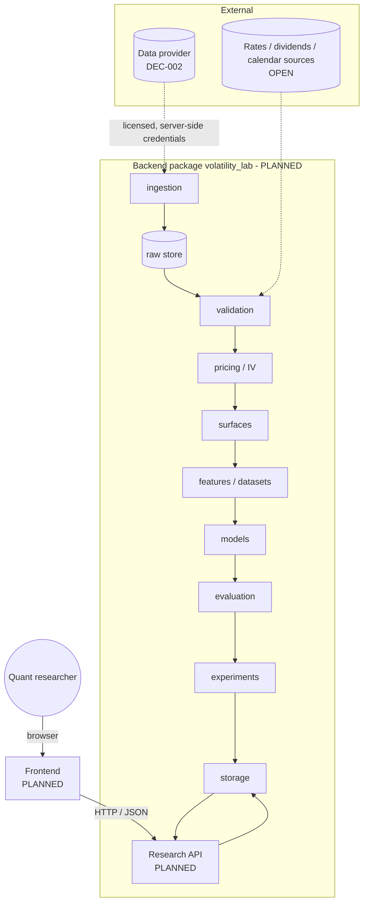
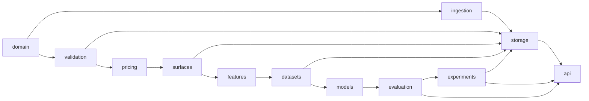

# architecture.md — Proposed System Architecture

**Status:** PROPOSED. This is the **conceptual** architecture derived from MP §5 and §18–§22. **Nothing described here is implemented** (the disposable Phase 0 synthetic spike in `scripts/phase0_synthetic/` does not implement this architecture and imports none of it). Where a technology is named it is an example or a `PROPOSED` option, never a decision (see [decision.md](decision.md)).
**Canonical for:** architectural principles, component responsibilities, domain boundaries, dependency rules, error/background/security/observability posture.
**Details live in:** [SYSTEM_OVERVIEW](docs/architecture/SYSTEM_OVERVIEW.md) (context & module map) · [DATA_FLOW](docs/architecture/DATA_FLOW.md) (stage contracts) · [STORAGE_DESIGN](docs/architecture/STORAGE_DESIGN.md) · [API_CONTRACTS](docs/architecture/API_CONTRACTS.md) · [ADR/](docs/architecture/ADR/)
**Related requirements:** NFR-001…012, SEC-001…007, FR-001…018 in [PR.md](PR.md).

**Implementation status of every component below: `PLANNED`** (directory placeholders exist under `backend/src/volatility_lab/`; they contain no code).

---

## 1. Architectural principles

1. **Raw is separate from derived.** Raw source observations are immutable (where licence allows); everything downstream is reproducible from raw + versioned config. (MP §5, §19)
2. **Every transformation is versioned and explainable.** Each stage records its method, parameters and code version; assumptions are data, not hidden in code. (MP §5)
3. **Independently testable layers with explicit contracts.** A stage's inputs and outputs are typed schemas; stages communicate via stored/versioned artifacts or function calls through narrow interfaces. (NFR-001)
4. **Separation of concerns:** data processing, training, inference, and visualization are distinct; the frontend neither trains nor computes science. (NFR-003)
5. **Historical mode first.** Reliable, reproducible historical workflow before any live updating. (NFR-009, MP §22)
6. **Provenance by construction.** Every surface cell/forecast can be traced to quotes, assumptions and versions (UI-010, SCI-013).
7. **Honest absence.** Missing, failed, interpolated and extrapolated are first-class states, not silent fills. (SCI-009, GR-QNT-02)
8. **Minimal complexity.** One deployable backend package, one frontend, file/embedded storage until a measured need says otherwise. No microservices, brokers or hosted registries without an ADR. (NFR-012, DEC-009/010)

## 2. System context

- Provider and reference-data sources are reachable **only** from `ingestion` (server side). Credentials never reach the frontend (SEC-001).
- The conceptual services in MP §18 (data, IV, surface, feature, model, evaluation, research API) map to **modules in one package**, not separate network services, until a documented need exists.

## 3. Component responsibilities

| Module (`backend/src/volatility_lab/…`) | Responsibility | Must not | Key requirements |
|---|---|---|---|
| `config` | Load/validate typed configuration (env + `configs/`); expose frozen config objects with a stable hash. | Hold secrets in files; read env outside this module. | NFR-007, SEC-001 |
| `domain` | Pure types & invariants: entities of MP §7, enums (quality flags, solver status, surface cell status, data mode), time/maturity value objects. | Perform I/O; import other modules. | DATA-008 |
| `ingestion` | Provider adapter interface + adapters; fetch, wrap with source metadata/timestamps, write raw snapshots. | Normalize or filter (that is `validation`); be imported by downstream modules. | FR-001, FR-002 |
| `validation` | Normalize, deduplicate, validate quotes, apply quote-selection policy, produce per-record flags and quality reports; market-calendar handling. | Discard silently; fetch data. | FR-003…006, DATA-005/006 |
| `pricing` | Pricing functions, bounds checks, IV solver with status/diagnostics. | Know about surfaces, storage, or providers. | FR-007, SCI-007/008 |
| `surfaces` | Coordinate transforms, grid definition, interpolation, status masks, surface diagnostics, construction metadata. | Fabricate observed values; extrapolate silently. | FR-008, SCI-009/011 |
| `features` | Versioned, origin-time-safe feature definitions. | Read data after the origin; fit state outside the training window. | FR-009, SCI-003 |
| `datasets` | Assemble versioned research datasets, chronological splits, walk-forward folds, scaler fitting boundaries. | Shuffle time series; leak across folds. | FR-009, FR-011, SCI-001/002 |
| `models` | Baselines (persistence, historical average, regression, statistical, parametric) and neural models behind one small forecaster interface. | Access test windows during selection; read raw data. | FR-010, FR-012, FR-013 |
| `evaluation` | Metrics, regional breakdowns with sample counts, walk-forward runner, robustness/ablation, calibration (if intervals). | Report aggregate-only results. | FR-011, SCI-004…006, SCI-010 |
| `experiments` | Run records, artifact hashing, reproducibility metadata, reproduce-from-record. | Depend on a hosted tracking service by default. | FR-014, SCI-013 |
| `storage` | Persistence for raw/derived/forecast/experiment data; versioning and lineage queries. | Contain business rules. | FR-002, DATA-004/007 |
| `api` | Thin transport: validation, authn/z, serialization, job submission. | Contain science or compute IV/surfaces. | FR-016, FR-017, SEC-002…004 |
| `observability` | Structured logging with redaction, run/job IDs, freshness & quality metrics. | Log secrets or raw licensed payloads. | NFR-006, SEC-005 |
| `frontend/` | Visualization and interaction only; consumes API. | Hold credentials; train/compute models; label interpolated values as observed. | UI-*, NFR-003 |

## 4. Domain boundaries and dependency rules

Allowed import direction (downstream-only; `domain` and `config` are importable by all, import no one):

- `pricing` is pure and I/O-free. `surfaces` depends on `pricing` outputs, never the reverse.
- `models` and `evaluation` never read `ingestion`/raw data; they consume `datasets`.
- `api` calls services through `storage`/`experiments` read paths and a job interface; it contains no science.
- Enforcement: import-direction architecture test (GR-ENG-03), `PLANNED`.

## 5. Data flow (summary)

`provider → raw snapshot → normalized quotes (+flags, exclusion log) → underlying/rate/dividend-aligned quotes → IV observations (+solver diagnostics) → surface snapshot (grid + status mask + method/version) → feature table / dataset version → forecasts (+uncertainty kind) → evaluation reports → experiment record → API → UI`.

Stage inputs/outputs, versions and invariants: [DATA_FLOW](docs/architecture/DATA_FLOW.md).

## 6. Proposed data contracts (conceptual)

Fields from MP §7; formal schemas are produced after the provider is chosen (DATA-008) in [DATA_DICTIONARY](docs/data/DATA_DICTIONARY.md). Cross-cutting contract rules:

- Every record carries `origin ∈ {provider, synthetic}`, `source`, `source_timestamp`, `ingested_at`, and the version IDs of the stage that produced it.
- IV is **decimal**; unit labels (vol points) appear only in presentation/report fields.
- Surface cells have `status ∈ {observed, interpolated, extrapolated, missing}` and, for non-missing cells, a link to contributing observations or construction parameters.
- IV observations: `iv` nullable, `solver_status` non-null enum, `failure_reason` non-null when `iv` is null.
- Forecast records: `forecast_origin`, `target_horizon`, `target_time`, `model_id`, `model_version`, `dataset_version`, `forecast_kind ∈ {historical_backtest, prospective}`, `uncertainty_kind`.

## 7. Storage boundaries

Three logical zones, physical layout `OPEN` (DEC-009): **raw** (immutable, source-faithful) → **derived** (versioned, reproducible from raw+config; safe to delete and rebuild) → **serving** (forecasts, experiment records, metadata queried by the API). Git holds code/config/docs only. See [STORAGE_DESIGN](docs/architecture/STORAGE_DESIGN.md).

## 8. Error handling

- **Expected data failures are values, not exceptions:** invalid quote → flagged and logged; solver failure → `iv = null` + status; sparse region → `missing`. They propagate with reasons and are counted in quality reports.
- **Unexpected failures** (I/O, bugs, provider outage) raise typed errors, are logged with context (run/job ID, stage, input version) and fail the job without partial publication.
- **Atomic publication:** a stage writes outputs to a staging location and publishes a version only on success; partial outputs are never visible to downstream stages or the API. Failed jobs are resumable/re-runnable idempotently from versioned inputs ([RECOVERY](docs/operations/RECOVERY.md)).
- **API:** consistent error envelope (no stack traces, no secrets); distinguishes *not found*, *invalid request*, *data unavailable*, *model failed*, *forbidden*.
- **Frontend:** every view handles loading/empty/partial/error/stale states ([design.md](design.md) §9).

## 9. Background processing

Ingestion, IV/surface construction, dataset builds, training and backtests are batch jobs that can exceed request time. Requirements (NFR-004, FR-017): submitted through the API (authorized), run outside the request path, observable (status, progress, logs), cancellable, resource-limited, idempotent by input version, and recoverable. The *mechanism* (in-process worker, OS scheduler, task queue) is `OPEN` and defaults to the simplest option that satisfies the above; a broker is not assumed (NFR-012). Scheduled ingestion only at the cadence the provider supports.

## 10. Security boundaries

| Boundary | Rule |
|---|---|
| Browser ↔ API | Untrusted input; validate everything; authn/z and rate limits when exposed beyond a local machine (SEC-002…004). |
| API ↔ backend modules | API passes validated, typed parameters; no raw strings into file paths or queries. |
| Backend ↔ provider | Credentials from environment/secret store, only inside `ingestion`; provider payloads validated before use. |
| Backend ↔ storage | Raw zone write-once; derived zone writable only by pipeline jobs; serving zone read-only for the API except job metadata. |
| Repo ↔ secrets/data | Nothing sensitive or licensed in Git ([.gitignore](.gitignore), GR-SEC-01). |
| Display/export ↔ licence | Exports carry source/licence metadata; display of licensed data follows DEC-002 outcome (SEC-006). |

Details: [docs/engineering/SECURITY.md](docs/engineering/SECURITY.md).

## 11. Observability

Structured logs with run/job/dataset/model IDs and secret redaction; metrics for data freshness, quote-exclusion rates, IV failure rates, surface coverage (share observed/interpolated/missing), job duration/failure, API latency/errors; health checks per pipeline stage and service. Quality and freshness are also product features (Data Quality view). See [docs/engineering/OBSERVABILITY.md](docs/engineering/OBSERVABILITY.md).

## 12. Performance considerations

Dominant costs are expected to be historical ingestion volume, IV solving across many contracts/snapshots (vectorizable), dataset assembly, neural training, and 3D rendering. No targets are asserted before measurement; targets are set after feasibility benchmarks (DEC-008, DEC-009). Strategies: cache immutable surface queries (keyed by version IDs), downsample geometry for rendering with an equivalent table view, avoid blocking UI loads. See [docs/engineering/PERFORMANCE.md](docs/engineering/PERFORMANCE.md).

## 13. Conceptual vs. implemented

| Element | Conceptual (this doc) | Implemented |
|---|---|---|
| Module layout | Yes | Empty directories only |
| Contracts/schemas | Rules only | None |
| Storage layout | Zones only | None |
| API | Endpoint categories only | None |
| Jobs | Requirements only | None |
| Frontend | Responsibilities only | None |

Update this table whenever a component moves beyond `PLANNED`.

## 14. Architectural risks

| Risk | Mitigation |
|---|---|
| Provider/licence dictates storage or display limits that invalidate the design | Decide provider and licence first (Phase 0); keep adapter + storage behind interfaces. |
| Over-building infrastructure before data volume is known | DEC-009 benchmark; YAGNI gate in review. |
| Schema churn after provider selection | Defer formal schemas to DATA-008; version all stored records. |
| Hidden coupling between `pricing` and `surfaces` conventions (maturity/moneyness) | Single convention module in `domain`; versioned in every snapshot. |
| Leakage via shared preprocessing state | Fit-state objects owned by `datasets` folds; truncation-invariance tests. |
| 3D rendering cost or accessibility problems | Feasibility prototype and table fallback before committing (DEC-008). |

## 15. Open decisions affecting architecture

Still open or only proposed (decision.md, 2026-10-21): DEC-002 (provider), DEC-004 (pricing), DEC-009 (storage), DEC-010 (tracking), DEC-011/012 (forecast representation, architecture), DEC-015 (toolchain). Decided by the owner: DEC-005 (coordinates), DEC-006 (grid), DEC-007 (stdlib API), DEC-008 (static 2D, no 3D) and DEC-013 (local only, no deployment). Status and evidence: [decision.md](decision.md).
