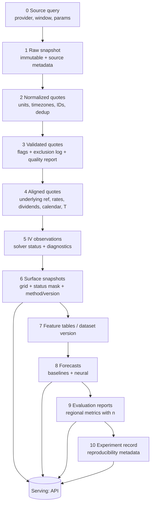

# Data Flow

**Status:** PROPOSED (contracts are conceptual until the provider is chosen, DATA-008) · **Canonical for:** stage-by-stage inputs/outputs, version keys, invariants, failure outputs · **Source:** MP §5, §8–§11, §19 · **Related:** [architecture.md](../../architecture.md), [DATA_VERSIONING](../data/DATA_VERSIONING.md), [STORAGE_DESIGN](STORAGE_DESIGN.md)

## 1. End-to-end flow

## 2. Stage contracts

| # | Stage (module) | Input | Output | Version key includes | Invariants | Failure behaviour |
|---|---|---|---|---|---|---|
| 0 | Query (`ingestion`) | provider, underlying, window, data mode | request log | provider adapter version, params | Credentials only from env/secret store | Fail job; nothing published |
| 1 | Raw snapshot (`ingestion`,`storage`) | provider responses | write-once raw records + source metadata (`source`, `source_timestamp`, `ingested_at`, `data_mode`, `origin`) | snapshot ID (content hash) | Byte-faithful where licence permits; never edited | Partial fetch → staged, not published |
| 2 | Normalize (`validation`) | raw snapshot | normalized quotes | normalizer version | Field/unit/timezone standardization; dedup by documented key; every input record accounted for | Unparseable → excluded with reason |
| 3 | Validate (`validation`) | normalized quotes + quote policy config | per-quote flags (retain/exclude/down-weight + reason), quality report | policy config hash | `ingested = retained + excluded`; reasons enumerated | Exclusions counted, never silent |
| 4 | Align (`validation`/`pricing` inputs) | validated quotes, underlying prices, rate & dividend assumptions, calendar | aligned quotes (underlying ref + timestamp, rate/dividend assumption ID, T by documented convention) | assumptions ID, calendar version, convention version | Underlying timestamp relation to quote recorded; one T convention | Missing underlying/rate → quote flagged `unalignable` |
| 5 | IV (`pricing`) | aligned quotes, selection policy, model | IV observations (`iv` nullable, `solver_status`, iterations, `failure_reason`, model, inputs) | pricing/solver version, tolerances | `iv` non-null ⇒ converged and reprices within tolerance; no fabricated IV | Null + reason |
| 6 | Surface (`surfaces`) | IV observations, grid & interpolation config | surface snapshot (grid values, per-cell status, contributing-observation links, method/version, diagnostics) | grid ID, interpolation version, coordinate convention | Statuses ∈ {observed, interpolated, extrapolated, missing}; observed cells trace to observations; no silent extrapolation | Sparse region → `missing` |
| 7 | Features/dataset (`features`,`datasets`) | surface snapshots, market-context series, feature definitions | feature table + dataset version + split/fold definitions | feature catalog version, dataset ID, split config | Features at origin *t* use data ≤ *t*; fit-state only from training view | Missing handled by documented rule + indicator |
| 8 | Forecast (`models`) | dataset view at origin, model config, seed | forecast grid(s), `forecast_kind`, `uncertainty_kind`, model version | model ID/version, config hash, seed | Baselines exist before neural; no test-window access in selection | Model failure → job fails with reason; no partial forecast stored |
| 9 | Evaluate (`evaluation`) | forecasts, realized surfaces, region & regime definitions | metrics by region/period/regime with `n`,`n_missing`; diagnostics; calibration if intervals | evaluation code version, metric config | Comparable cells only; counts reported | Insufficient-n flagged |
| 10 | Experiment record (`experiments`) | all of the above IDs | run record (SCI-013 fields) | record ID | Complete before results are published | Incomplete record ⇒ result unpublishable |

## 3. Lineage

A displayed value must resolve backwards: **UI value → forecast/surface cell → (observation IDs | interpolation parameters) → IV observation → aligned quote → validated quote + flags → raw record**, plus config/code versions at each hop (UI-010). Each artifact stores the IDs of its direct inputs, so lineage is a graph walk, not a search.

## 4. Time semantics

- *Quote timestamp* vs *snapshot timestamp* vs *underlying reference timestamp* are distinct fields; any gap between them is recorded and thresholds are in the quote policy.
- *Forecast origin* *t*: all inputs ≤ *t*. *Target time*: next valid trading session after *t* per the market calendar (DATA-006).
- Revised or corrected data creates a new version; a historical result pins the version it used (DATA-004).

## 5. Validation of this document
Phase 1: conservation test for stages 2–3; determinism test for stage 1→3. Phase 2: recovery tests for stage 5; hash-reproducibility for stage 6. Phase 3: truncation-invariance for stage 7; reproducibility for stages 8–10. A stage contract that cannot be tested is revised before implementation.
