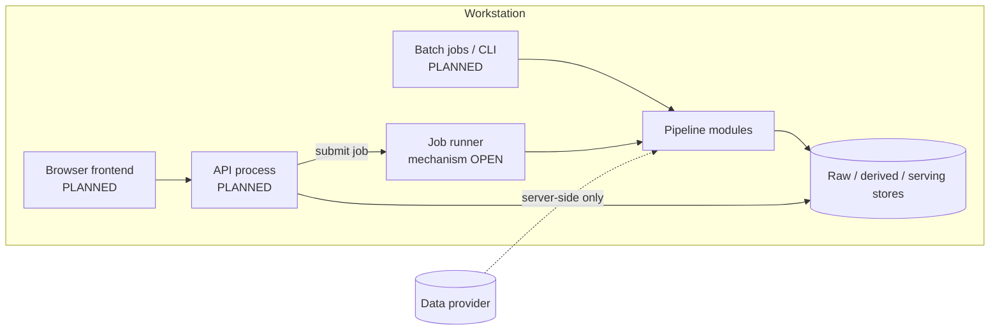

# System Overview

**Status:** PROPOSED (conceptual; nothing implemented) · **Scope:** runtime/process view, module map, mapping of MP service boundaries to modules, local-first topology. **Principles, responsibilities, boundaries, security, errors:** see [architecture.md](../../architecture.md) (canonical) — not repeated here. **Stage contracts:** [DATA_FLOW](DATA_FLOW.md). **Related:** [STORAGE_DESIGN](STORAGE_DESIGN.md), [API_CONTRACTS](API_CONTRACTS.md), MP §5, §18, §22.

## 1. Mapping MP §18 "services" to modules

MP lists conceptual service boundaries. They are implemented as **modules of one backend package** (`backend/src/volatility_lab/`), not network services, unless a documented need arises (NFR-012).

| MP service | Module(s) | Interface style |
|---|---|---|
| Data service | `ingestion`, `storage` | Python interface (`ProviderAdapter` concept), job entry |
| IV service | `validation`, `pricing` | Pure functions over typed records |
| Surface service | `surfaces` | Pure functions + config → snapshot |
| Feature service | `features`, `datasets` | Versioned builders |
| Model service | `models` | Forecaster interface: `fit(train_view) → state`, `predict(origin_view) → forecast` |
| Evaluation service | `evaluation` | Fold runner + metric functions |
| Research API | `api` | HTTP/JSON, thin |
| Frontend | `frontend/` | Browser app consuming the API |

The forecaster interface above is a conceptual sketch to show where leakage boundaries sit (`fit` sees only the training view; `predict` sees only data up to the origin); it is **not** a committed signature.

## 2. Runtime view (local-first, historical mode)

- Single machine, no network services other than the optional local API/UI.
- Long-running work (ingestion, IV/surface builds, dataset builds, training, backtests) runs as batch jobs that read and write versioned artifacts; the API only submits and inspects jobs (FR-017).
- Multi-user/remote deployment is deferred to Phase 6 (DEC-013).

## 3. Module map to repository paths

| Path | Module | Phase introduced |
|---|---|---|
| `backend/src/volatility_lab/config` | configuration | 1 |
| `…/domain` | entities, enums, conventions | 1 |
| `…/ingestion` | provider adapters, raw snapshot writer | 1 |
| `…/validation` | normalization, quote policy, quality reports | 1 |
| `…/pricing` | pricing, bounds, IV solver | 2 |
| `…/surfaces` | coordinates, grid, interpolation, masks | 2 |
| `…/features`, `…/datasets` | feature builders, dataset/folds | 3 |
| `…/models` | baselines (3), neural (4) | 3–4 |
| `…/evaluation` | metrics, walk-forward, robustness | 3–4 |
| `…/experiments` | run records, reproduction | 3 |
| `…/storage` | persistence & lineage | 1 |
| `…/api` | transport | 5 |
| `…/observability` | logging/metrics | 1 |
| `frontend/` | UI | 5 |
| `tests/…` | unit / integration / scientific / e2e / regression | each phase |

All directories currently contain only placeholders.

## 4. Cross-cutting contracts

- **Version keys:** every artifact has an ID derived from content/config (see [DATA_VERSIONING](../data/DATA_VERSIONING.md)); downstream artifacts store their upstream IDs (lineage).
- **Config:** typed, validated, hashed; the hash is stored with outputs.
- **Time:** UTC internally, source timezone preserved; one convention module.
- **Status/flag enums** live in `domain` and are shared with the API schema and the UI.

## 5. Validation of this document

When code exists: (a) import-direction test matches the dependency graph in architecture.md §4; (b) a lineage walk from any surface cell to raw record succeeds on a synthetic dataset; (c) this document's module map matches the repository tree. Until then: reviewed by the owner (`PROPOSED`).
