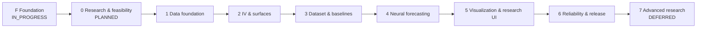

# Roadmap

**Status:** PROPOSED · **Source:** MP §23 (preserved) · **Canonical details:** [IMPLEMENTATION_PLAN](../../IMPLEMENTATION_PLAN.md) · **Related:** [MILESTONES](MILESTONES.md), [RISKS](RISKS.md)

This is the one-page sequence. Scope, acceptance and gates live in the implementation plan; do not restate them here.

| Phase | Theme | MP exit criteria (verbatim intent) | Key decisions resolved |
|---|---|---|---|
| 0 | Research & feasibility | Written data-source decision, documented scope, sample data sufficient to test the full analytical path | DEC-001, 002, 003, 015; drafts of 004/005 |
| 1 | Data foundation | Repeatable ingestion and auditable quality checks | DEC-009 |
| 2 | IV & surfaces | Verified IV calculations and reproducible surface snapshots | DEC-004, 005, 006 |
| 3 | Dataset & baselines | Trustworthy baseline performance with leakage checks | DEC-010, 011 |
| 4 | Neural forecasting | Reproducible out-of-sample results and clear evidence of where the neural model helps or fails | DEC-012 |
| 5 | Visualization & research UI | Users can inspect how a forecast was produced and evaluate it without reading source code | DEC-007, 008 |
| 6 | Reliability & release | Stable, documented application with reproducible results and honest limitations | DEC-013, 014 |
| 7 | Advanced research | Per approved extension | per proposal |

## Sequencing principles
1. Data and licence before code; science validated before UI polish.
2. No later phase is complete because an earlier one produced documentation only.
3. Spikes may precede decisions but never become product code.
4. No calendar dates or effort estimates are asserted: durations depend on data availability and decisions (to be estimated at Phase 0 exit).

## Critical path
Provider + licence (DEC-002) → minimum viable dataset → pricing/convention decisions → verified IV → baselines with leakage checks → neural comparison → UI. The earliest blocking risk is data availability (RISK-01).
