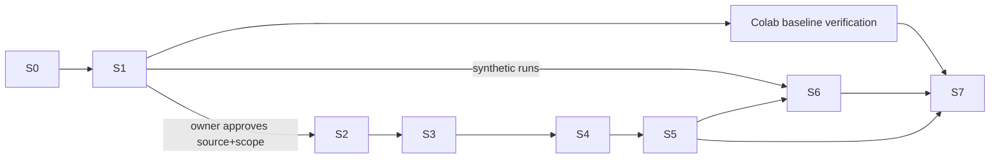

# MASTER_PLAN — multi-agent execution stages

**Status:** orchestration layer created 2026-10-20. **Canonical phase scope/gates stay in** [IMPLEMENTATION_PLAN](../IMPLEMENTATION_PLAN.md); this file maps *execution stages S0–S7* onto them and tracks coordination status. A stage is `ACCEPTED` only with linked evidence, never because a report exists. Each stage has a contract in [contracts/](contracts/) and a launch prompt in [prompts/](prompts/).

| Stage | Name | Repo phase(s) | Owner | Depends on | Status (2026-10-20) | Gate to accept |
|---|---|---|---|---|---|---|
| S0 | Baseline & orchestration setup | — | Orchestrator | — | **IN_REVIEW** (artifacts written; awaiting owner read) | Baseline documented, ownership clear, prompts usable |
| S1 | Engineering stabilization & source resolution | 0, 1–5 (static) | Orchestrator + A,B,C,D,E | S0 | **IN_PROGRESS** (Wave 1 running) | Reports A–E independently reviewed (F); source options documented; next-experiment prerequisites listed |
| S2 | Authorized data ingestion | 0, 1 | Agent C (adapter) + B | S1 **and owner approval of source + scope** | **BLOCKED** (no approval; no source chosen) | Authorized data ingested in Colab, validated, ledger conserved |
| S3 | IV & surface construction (real data) | 2 | Agent C | S2 | **BLOCKED** (needs S2). Synthetic-only hardening may continue under S1 patches | Real-data surface rebuilt reproducibly in Colab, or exact blocker documented |
| S4 | Baselines & evaluation | 3 | Agent D (design) + C | S3, frozen thresholds | **BLOCKED** (needs S3). Design drafted in S1 | Baseline results reproducible in Colab, independently reviewed |
| S5 | Neural forecasting | 4 | Agent D + C | S4, GPU in Colab, owner approval to train | **BLOCKED** | Predefined evidence criteria met, or negative result recorded |
| S6 | UI/API/E2E integration | 5 | Agent E + UI session | S1 (synthetic runs OK); real outputs need S4–S5 | **READY for synthetic-run E2E in Colab once Colab connects**; real-data screens BLOCKED | UA journeys executed with evidence |
| S7 | Reliability, review, release readiness | 6 | Orchestrator + F | S1–S6 | **NOT_STARTED** (CI never run; needs owner push) | Full suite in Colab; all gates evidenced or project marked incomplete with blockers |

## Dependency graph

## Safe parallel work now (Wave 1, running) vs sequential gates
- **Parallel, independent (no shared files):** A audit, B source research, C defect hunt (proposals only), D methodology audit, E UI/API inspection — each owns one report file.
- **Next wave (after Wave 1 returns):** F independent review (needs A–E); Colab baseline run V-1 (needs Colab connection); apply F-accepted C patches one owner at a time, then re-verify in Colab; UI-session fixes for E's findings.
- **Hard gates (human):** source/scope approval → S2; training approval → S5; commit/push; any paid resource. See [APPROVALS](APPROVALS.md).

## Standing policies (2026-10-21; recorded in [DECISIONS](DECISIONS.md) OR-D1–OR-D6, nothing implemented)
- **S2 data:** modular multi-source strategy (small adapters, normalized schema, lightweight manifest, no database/streaming); every source needs licence review and owner approval first. The SPY set stays a preserved reference, not an authorized input (DEC-002).
- **S4/S5:** existing SPY models and results are preserved; new data never auto-triggers retraining; the order is verify data → freeze baseline → compatibility check → time-aware evaluation → report → **approval before retraining**. Cross-market use of SPY-trained models is unsupported until shown compatible.
- **S6:** local 2D research dashboard; no "live" wording; withdrawn-dataset content and the 3D view are queued UI corrections.
- **S7:** no public hosting or redistribution; a release needs a separate decision and licence review.

## Claims policy
Nothing in this plan states a gate passed. "Ready" means prerequisites are met, not that work is done.
